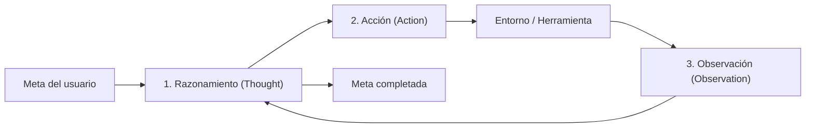

# Agentes Autónomos de Inteligencia Artificial

Un modelo de lenguaje tradicional responde preguntas con soltura, pero no puede interactuar directamente con su entorno. Si se le pide comprar un billete o corregir un fallo en un programa, redactará pasos detallados, pero dependerá de que una persona los ejecute. Un agente autónomo rompe este límite: utiliza el modelo como motor de decisión dentro de un ciclo interactivo que consulta herramientas, ejecuta acciones en ordenadores o bases de datos, examina las respuestas y rectifica sus pasos hasta cumplir una meta con mínima supervisión humana.

> **En pocas palabras:** Un agente autónomo es un sistema de inteligencia artificial que combina razonamiento con herramientas externas para planificar, actuar, comprobar sus resultados y resolver tareas de principio a fin.

## 1. De dónde viene y cómo se entiende fácil

Para visualizar cómo opera un agente, ayuda compararlo con la diferencia entre un asesor telefónico y un asistente de oficina. Si llamas a un asesor para saber cómo liquidar impuestos, te indicará qué casillas completar y qué portal web visitar, pero el trámite bancario debes realizarlo tú. En cambio, un asistente de oficina con facultades delegadas entra al portal tributario, coteja facturas, entra en la banca en línea, efectúa el pago, descarga el comprobante y te entrega la confirmación. Si el sistema bancario falla a mitad del proceso, el asistente no se rinde: espera unos minutos, prueba con otro navegador o recurre a una cuenta de respaldo.

Esa capacidad de persistir y modificar su entorno define a los agentes. El concepto no nació con los modelos de lenguaje. En 1987, el filósofo Michael Bratman formuló el modelo BDI (*Belief-Desire-Intention*, Creencias-Deseos-Intenciones): un agente racional mantiene una imagen del mundo (creencias), define metas (deseos) y ejecuta planes para alcanzarlas (intenciones). En 1995, Stuart Russell y Peter Norvig fijaron en su manual clásico la definición moderna: un agente es cualquier sistema computacional que percibe su entorno mediante sensores y actúa sobre él a través de actuadores o herramientas.

Durante décadas, los agentes se programaron con reglas lógicas rígidas escritas a mano que colapsaban ante imprevistos. El cambio decisivo ocurrió entre 2022 y 2023, al comprobarse que los modelos de lenguaje extenso (LLM) podían actuar como planificadores cognitivos, traduciendo metas cotidianas en secuencias de comandos informáticos.

## 2. Cómo funciona por dentro

A diferencia de un buscador que opera en una sola dirección, un agente funciona en bucle cerrado. Cada ciclo consta de cuatro pasos:

1. **Percepción:** Recibe la meta inicial o la respuesta de una acción previa.
2. **Razonamiento:** Analiza la situación y decide el siguiente paso.
3. **Acción:** Emite una orden técnica estructurada (consulta SQL o llamada web) hacia un programa externo.
4. **Observación:** El entorno ejecuta la orden y devuelve los datos o errores resultantes al agente para reiniciar la evaluación.



### El patrón ReAct y su formalización

En 2022, investigadores de la Universidad de Princeton y Google presentaron el método ReAct (*Reasoning and Acting*, razonamiento y acción). Antes de este marco, los modelos invocaban comandos sin deliberar, cometiendo fallos frecuentes. ReAct introdujo una alternancia estricta entre pensamientos explícitos y acciones operativas: al escribir primero su reflexión, el modelo estructura su memoria de trabajo antes de invocar cualquier herramienta.

Matemáticamente, un agente se modela sobre un Proceso de Decisión de Markov Parcialmente Observable (POMDP), donde solo recibe observaciones parciales del entorno. Si la meta inicial es M, en cada paso t el agente acumula una memoria de contexto c_t formada por reflexiones (r), acciones (a) y observaciones (o):

```text
c_t = (M, r_1, a_1, o_1, ..., r_t-1, a_t-1, o_t-1)
```

La política del agente, gobernada por los parámetros del modelo (θ), decide la siguiente acción:

```text
Acción siguiente = Política_θ(c_t)
```

### De Function Calling a Model Context Protocol (MCP)

Para comunicarse con software tradicional, los modelos necesitan generar formatos exactos. En junio de 2023, OpenAI introdujo la llamada a funciones (*Function Calling*), que genera argumentos JSON validados contra esquemas tipados.

Para evitar integraciones aisladas, Anthropic presentó en noviembre de 2024 el Protocolo de Contexto de Modelos (MCP, *Model Context Protocol*). MCP es un estándar abierto sobre JSON-RPC 2.0 que conecta modelos con herramientas externas mediante tres elementos:

* **Recursos (*Resources*):** Datos de solo lectura (archivos, registros o bases de datos).
* **Indicaciones (*Prompts*):** Plantillas para estructurar flujos de trabajo específicos.
* **Herramientas (*Tools*):** Funciones ejecutables con efectos reales (ejecutar código o peticiones web).

```python
# Bucle básico de un agente con herramientas
class AgenteMinimo:
    def __init__(self, cliente_ia, herramientas):
        self.ia = cliente_ia
        self.herramientas = herramientas
        self.historial = []

    def ejecutar(self, objetivo: str) -> str:
        self.historial.append({"rol": "usuario", "contenido": objetivo})
        while True:
            respuesta = self.ia.generar(self.historial, self.herramientas.esquemas())
            if not respuesta.llamadas_a_herramientas:
                return respuesta.texto
            
            for llamada in respuesta.llamadas_a_herramientas:
                funcion = self.herramientas.obtener(llamada.nombre)
                resultado = funcion(**llamada.argumentos)
                self.historial.append({"rol": "asistente", "llamada": llamada})
                self.historial.append({"rol": "herramienta", "resultado": str(resultado)})
```

## 3. Dónde se usa hoy en la vida real

* **Ingeniería de software:** Herramientas como Devin (Cognition, 2024) y Claude Code (Anthropic) resuelven incidencias leyendo repositorios, ejecutando pruebas en terminales y corrigiendo código hasta reparar fallos sin supervisión constante.
* **Química computacional:** La plataforma ChemCrow (2023, EPFL y Rochester) conecta modelos de lenguaje con 18 herramientas químicas para planificar y validar rutas de síntesis orgánica en laboratorios digitales.
* **Ciberseguridad:** Agentes de seguridad analizan telemetría de red, cruzan indicadores de compromiso con catálogos de amenazas y configuran reglas de cortafuegos ante incidentes.
* **Finanzas y administración:** Empresas despliegan agentes para procesar balances contables, extraer tablas numéricas con scripts de Python y conciliar movimientos bancarios de forma continua.

## 4. Qué hace bien, qué falla y qué riesgos tiene

| Criterio | Asistente de Chat Convencional | Agente Autónomo Individual | Sistema Multi-Agente Coordinado |
| :--- | :--- | :--- | :--- |
| **Capacidad de acción** | Solo redacta texto explicativo | Alta en tareas secuenciales delimitadas | Excelente en problemas complejos con división de tareas |
| **Consumo computacional** | Fijo y reducido por consulta | Variable y sensible a reintentos | Crítico por la interacción continua entre agentes |
| **Latencia** | Inmediata (de 1 a 4 segundos) | Moderada (de 20 segundos a varios minutos) | Elevada (procesos de minutos u horas) |
| **Autocorrección** | Inexistente (si alucina, no rectifica) | Media (corrige errores devueltos por herramientas) | Alta (evaluación y debate cruzado entre roles) |
| **Superficie de riesgo** | Baja (restringida a texto inexacto) | Media (posible ejecución indebida de comandos) | Alta (vectores de contagio entre agentes) |

### Riesgos operativos y brechas de seguridad

* **Inyección indirecta de instrucciones (*Prompt Injection*):** Descrita por Kai Greshake y su equipo en 2023, ocurre cuando un agente procesa datos externos no confiables (correos o páginas web) con instrucciones maliciosas ocultas que inducen a filtrar datos confidenciales o ejecutar órdenes no autorizadas.
* **Bucles infinitos y consumo desmedido:** Ante fallos imprevistos de un servicio externo, el agente puede reiterar llamadas infructuosas indefinidamente, agotando el presupuesto de cómputo si carece de límites de parada estrictos.
* **Efectos irreversibles:** Modificar bases de datos en producción o autorizar pagos exige entornos aislados (*sandboxes*) y confirmación humana obligatoria (*Human-in-the-Loop*) antes de consumar acciones críticas.

## 5. Temas relacionados

* **Generación Aumentada por Recuperación (RAG):** Método que provee a los agentes de memoria documental externa para consultar información actualizada.
* **Protocolo de Contexto de Modelos (MCP):** Arquitectura abierta promovida por Anthropic para estandarizar la conexión de herramientas y recursos.
* **Árboles de Pensamiento (Tree of Thoughts):** Técnica de búsqueda deliberativa que evalúa múltiples alternativas lógicas antes de actuar.
* **Alineación y Seguridad en IA:** Marcos técnicos para garantizar que las acciones autónomas se mantengan dentro de límites operativos seguros.
