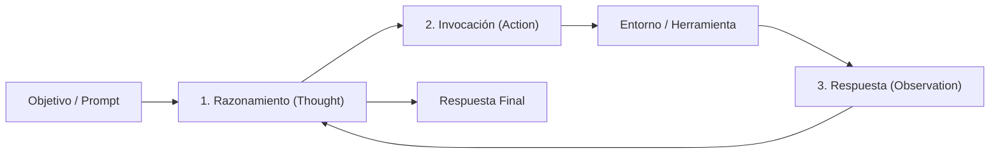

# Agentes Autónomos de IA: Arquitecturas Cognitivas, Protocolos de Integración y Sistemas Multi-Agente

Un **agente autónomo basado en modelos de lenguaje (LLM)** es un sistema computacional capaz de percibir su entorno, mantener un estado interno de memoria, formular planes estratégicos y ejecutar acciones discretas mediante interfaces externas para resolver metas complejas con mínima intervención humana. A diferencia de un modelo fundacional pasivo —cuya computación concluye con la emisión estocástica de texto—, un agente autónomo sitúa al modelo como motor cognitivo central dentro de un bucle de retroalimentación cerrado (*closed-loop feedback*). Esto le permite interactuar con bases de datos, APIs, compiladores y sistemas operativos, transformando el lenguaje natural en capacidad de agencia y resolución determinista de problemas.

---

## 1. Origen e Intuición Fundamental

La conceptualización formal de agentes inteligentes se remonta a la cibernética y la teoría clásica de sistemas multi-agente formulada por Russell y Norvig, así como a las arquitecturas BDI (*Belief-Desire-Intention*) de Michael Bratman. En dichos esquemas tradicionales, un agente evalúa el estado del mundo (creencias), define metas a satisfacer (deseos) y selecciona secuencias de acción para alcanzarlas (intenciones). Sin embargo, los agentes simbólicos clásicos sufrían de fragilidad ante la ambigüedad del mundo real y la explosión combinatoria de estados.

La convergencia entre los modelos de lenguaje a gran escala y la teoría de control cognitivo resolvió esta barrera histórica. Un LLM preentrenado alberga representaciones implícitas del mundo, de la lógica formal y de la sintaxis algorítmica. Al integrarlo dentro de un ciclo recursivo de **Percepción $\rightarrow$ Planificación $\rightarrow$ Acción $\rightarrow$ Observación**, el sistema deja de operar en ciclo abierto (*open-loop*) y pasa a funcionar como un controlador adaptativo capaz de refinar sus hipótesis a partir de los resultados reales que devuelve el entorno de ejecución.

---

## 2. Arquitectura, Mecánica o Formulación Matemática

### 2.1. Formalización del Bucle Percepción-Planificación-Acción
Desde la teoría de decisión, un agente autónomo opera sobre un Proceso de Decisión de Markov Parcialmente Observable (POMDP), definido por la tupla $(S, A, \Omega, \mathcal{T}, \mathcal{O}, \mathcal{R}, \gamma)$, donde:
*   $S$ representa el espacio de estados del entorno (ej. estado de un repositorio o base de datos).
*   $A$ es el espacio de acciones admisibles (llamadas a herramientas o comandos).
*   $\Omega$ es el conjunto de observaciones captadas por el agente.
*   $\mathcal{T}(s' \mid s, a)$ es la función de transición de estado.
*   $\mathcal{O}(o \mid s', a)$ modela la probabilidad de percibir la observación $o$ tras ejecutar la acción $a$.

En cada paso temporal $t$, el agente actualiza su estado de contexto $c_t$:
$$c_t = (q, \tau_1, a_1, o_1, \dots, \tau_{t-1}, a_{t-1}, o_{t-1})$$
donde $q$ es la meta inicial, $\tau_k$ es la traza de razonamiento interno, $a_k$ es la acción ejecutada y $o_k$ es la observación devuelta. El agente parametriza su política de acción mediante el LLM $\pi_\theta(a_t, \tau_t \mid c_t)$.

### 2.2. El Paradigma ReAct (Reasoning and Acting)
Introducido por Yao et al. (2022), el patrón **ReAct** entrelaza la generación de razonamientos deliberativos explícitos (*Thoughts*) con acciones operativas (*Actions*). Esta separación mitiga la propagación de alucinaciones:
1.  **Pensamiento ($\tau_t$):** Descompone la meta, analiza la observación previa y ajusta el plan.
2.  **Acción ($a_t$):** Emite una llamada estructurada hacia una herramienta disponible (ej. `query_database(...)`).
3.  **Observación ($o_t$):** El entorno ejecuta la acción y devuelve el resultado directo al búfer de contexto.



### 2.3. De Function Calling al Model Context Protocol (MCP)
Los modelos fundacionales modernos implementan **Function Calling** nativo: a partir de una especificación JSON Schema, el modelo genera tokens restringidos sintácticamente que representan argumentos validados para ejecución externa.

Para superar la fragmentación de integraciones aisladas, la industria introdujo el **Model Context Protocol (MCP)**, un protocolo abierto que estandariza la comunicación entre hosts de IA y servidores de contexto sobre JSON-RPC 2.0 (usando transportes `stdio` o `SSE`). MCP define tres primitivas esenciales:
*   **Resources:** Datos pasivos contextuales (archivos locales, registros o esquemas SQL).
*   **Prompts:** Flujos de trabajo y plantillas parametrizadas predefinidas.
*   **Tools:** Funciones ejecutables con efectos secundarios computacionales que devuelven resultados al agente.

### 2.4. Topologías en Sistemas Multi-Agente (MAS)
Cuando la complejidad excede la ventana de contexto de un único agente, se coordinan **Sistemas Multi-Agente**:
*   **Jerárquica (Supervisor / Worker):** Un coordinador central descompone la meta global en subtareas asignadas a agentes especializados.
*   **Consenso y Debate:** Múltiples agentes con distintos roles evalúan hipótesis concurrentemente y convergen mediante votación ponderada o refinamiento cruzado.

```python
# Implementación mínima de un ciclo de agente con llamada a herramientas
import json

class AgentKernel:
    def __init__(self, llm_client, tools: dict):
        self.client = llm_client
        self.tools = tools
        self.context = []

    def step(self, user_prompt: str) -> str:
        self.context.append({"role": "user", "content": user_prompt})
        while True:
            # 1. Percepción y Razonamiento: Generación con esquemas de herramientas
            response = self.client.generate(messages=self.context, tools=self.tools.schemas())
            
            # Si concluye sin requerir más acciones, finaliza el ciclo
            if not response.tool_calls:
                self.context.append({"role": "assistant", "content": response.content})
                return response.content
            
            # 2. Acción y 3. Observación: Ejecución determinista de la herramienta
            for call in response.tool_calls:
                tool_fn = self.tools.get(call.function_name)
                args = json.loads(call.arguments)
                observation = tool_fn(**args)
                
                # Inyección del resultado en la memoria episódica
                self.context.append({"role": "assistant", "tool_calls": [call]})
                self.context.append({"role": "tool", "call_id": call.id, "content": str(observation)})
```

---

## 3. Casos de Uso y Aplicaciones Reales

*   **Ingeniería de Software Autónoma:** Plataformas como Devin o Claude Code ejecutan ciclos completos de lectura de repositorios, diagnóstico de errores mediante terminal bash, modificación selectiva de código fuente y ejecución de suites de pruebas unitarias hasta corregir regresiones.
*   **Investigación Científica y Descubrimiento Molecular:** Sistemas como ChemCrow integran modelos de lenguaje con herramientas de química computacional, simuladores de síntesis orgánica y bases moleculares para diseñar rutas de reacción viables.
*   **Operaciones de Ciberseguridad Defensiva:** Agentes autónomos monitorean flujos de telemetría de red, correlacionan indicadores de compromiso (IoC) y despliegan reglas de contención en firewalls sin retardos manuales.
*   **Automatización de Procesos Empresariales (RPA 2.0):** Coordinación dinámica entre sistemas ERP, CRM y pasarelas de pago mediante MCP para consultar inventarios e interactuar mediante transacciones garantizadas.

---

## 4. Ventajas, Limitaciones y Riesgos

| Dimensión | LLM Aislado (Sin Herramientas) | Agente ReAct Monolítico | Sistema Multi-Agente (MAS + MCP) |
| :--- | :--- | :--- | :--- |
| **Capacidad Resolutiva** | Limitada a predicción textual estática | Alta para tareas secuenciales directas | Excepcional en problemas heterogéneos |
| **Consumo de Tokens** | Constante $O(1)$ por inferencia | Moderado a alto por reintentos | Crítico; crecimiento cuadrático $O(N^2)$ en debate |
| **Latencia de Respuesta** | Baja ($\sim$1 a 3 segundos) | Media ($\sim$10 a 45 segundos) | Elevada (minutos según concurrencia) |
| **Superficie de Ataque** | Inyección de prompt directa básica | Riesgo medio (fugas vía herramientas) | Alto (inyección indirecta, llamadas remotas) |
| **Manejo de Errores** | Nulo; alucina sin verificar | Auto-corrección iterativa local | Auditoría cruzada y replanificación global |

### Riesgos Críticos y Vectores de Vulnerabilidad
1.  **Inyección Indirecta de Prompts:** Un agente que lee correos o sitios web externos puede procesar texto malicioso diseñado para alterar sus directivas y ejecutar herramientas destructivas (ej. `delete_database()` o fuga de credenciales).
2.  **Bucles Infinitos y Deriva de Estado (*State Drift*):** En espacios no acotados, el agente puede encadenar razonamientos redundantes consumiendo cómputo sin aproximarse a la solución.
3.  **Efectos Secundarios Irreversibles:** La ejecución de comandos en producción exige sandboxes efímeros y mecanismos de supervisión *Human-in-the-Loop* (HITL).

---

## 5. Conceptos Relacionados

*   **Recuperación Aumentada por Generación (RAG):** Mecanismo de enriquecimiento contextual que dota a los agentes de memoria no paramétrica externa.
*   **Aprendizaje por Refuerzo con Retroalimentación Humana (RLHF):** Técnica de alineación subyacente que capacita a los modelos para seguir instrucciones precisas de invocación de herramientas.
*   **Model Context Protocol (MCP):** Estándar de interoperabilidad para la integración modular de servidores de recursos y herramientas en entornos multi-agente.
*   **Árboles de Pensamiento (Tree of Thoughts - ToT):** Estrategia de planificación algorítmica donde el agente explora múltiples ramas de razonamiento prospectivo y heurístico.
