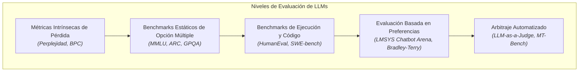

# Evaluación de Modelos de Inteligencia Artificial: Métricas Intrínsecas, Benchmarks Estandarizados, Contaminación y Dinámicas de Preferencia

La **evaluación de modelos de inteligencia artificial**, en particular de los Modelos de Lenguaje de Gran Escala (*Large Language Models* o LLMs), constituye la disciplina metodológica y matemática orientada a cuantificar rigurosamente las capacidades cognitivas, el razonamiento formal, la alineación con instrucciones humanas y la fiabilidad operativa de los sistemas generativos. A diferencia del aprendizaje automático tradicional, donde la optimización sobre conjuntos de prueba cerrados mediante métricas puntuales (como exactitud o puntaje F1) resultaba suficiente, la naturaleza abierta, multimodal y no estructurada de las salidas generativas exige un espectro multidimensional de evaluación: desde métricas probabilísticas intrínsecas del modelado autorregresivo hasta baterías estandarizadas de problemas, entornos de ejecución de código agéntico, arbitrajes automatizados y modelos estadísticos de preferencia ciega por pares.

---

## 1. Origen e Intuición Fundamental

Durante las etapas iniciales del Procesamiento del Lenguaje Natural (PLN), la evaluación de modelos secuenciales se sustentó en medidas estadísticas de alineación léxica de n-gramas como **BLEU** (*Bilingual Evaluation Understudy*) y **ROUGE** (*Recall-Oriented Understudy for Gisting Evaluation*). Si bien estas métricas permitieron automatizar el análisis en traducción y resumen, adolecían de una limitación intrínseca: la incapacidad estructural para valorar la coherencia semántica global, la corrección fáctica, la sintaxis funcional y la creatividad, penalizando formulaciones válidas pero formalmente divergentes del texto de referencia.

Con la consolidación de la arquitectura Transformer y los paradigmas de preentrenamiento autorregresivo masivo, la comunidad adoptó métricas probabilísticas basadas en la teoría de la información (entropía cruzada y perplejidad). Sin embargo, a medida que los modelos exhibieron capacidades emergentes mediante el aprendizaje en contexto (*in-context learning*) y el ajuste fino por instrucciones (*instruction tuning*), surgió la necesidad imperativa de medir el razonamiento abstracto y la competencia disciplinar en dominios específicos.



Esta evolución condujo a una transición epistemológica: desde suites estáticas de preguntas cerradas (como MMLU) hacia evaluaciones de ejecución dinámica en entornos interactivos (como SWE-bench) y marcos de juicio humano descentralizado (como LMSYS Chatbot Arena). Simultáneamente, la ubicuidad de los datos de evaluación en la web abierta introdujo el fenómeno de la **contaminación de datos**, reactivando la vigencia de la **Ley de Goodhart**: cuando una métrica se convierte en un objetivo de optimización, deja de ser una medida confiable.

---

## 2. Arquitectura, Mecánica o Formulación Matemática

### A. Métricas Intrínsecas: Entropía Cruzada y Perplejidad (PPL)

En el preentrenamiento autorregresivo, un modelo de lenguaje modela la probabilidad conjunta de una secuencia de tokens $X = (x_1, x_2, \dots, x_N)$ factorizada mediante la regla de la cadena:

$$P(X) = \prod_{i=1}^N P(x_i \mid x_1, \dots, x_{i-1})$$

La **entropía cruzada media** ($\mathcal{L}_{CE}$) sobre el corpus cuantifica la divergencia de información respecto a la distribución empírica de los datos:

$$\mathcal{L}_{CE}(X) = - \frac{1}{N} \sum_{i=1}^N \log P(x_i \mid x_{<i})$$

La **Perplejidad** ($\text{PPL}$) es el exponente natural de la entropía cruzada:

$$\text{PPL}(X) = \exp(\mathcal{L}_{CE}(X)) = \left( \prod_{i=1}^N \frac{1}{P(x_i \mid x_{<i})} \right)^{1/N}$$

Intuitivamente, la perplejidad representa el número efectivo de ramificaciones léxicas equiprobables que el modelo pondera al predecir cada nuevo token. Un valor inferior refleja mayor certeza.

> [!WARNING]
> La perplejidad es estrictamente dependiente de la arquitectura del tokenizador. Comparar la perplejidad entre modelos que operan con vocabularios de distinto tamaño ($|V|$) conduce a conclusiones falaces; para normalizar esta discrepancia se requiere calcular los **bits por carácter** (*bits per character*, BPC) o **bits por byte** (*bits per byte*, BPB).

---

### B. Benchmarks Estandarizados: De la Inferencia Estática a la Autonomía Agéntica

1. **MMLU (*Massive Multitask Language Understanding*):**
   Evalúa el conocimiento fáctico y razonamiento en 57 materias que abarcan ciencias formales, humanidades y ciencias sociales. Se evalúa formalmente en configuraciones *zero-shot* o *few-shot* (habitualmente 5 disparos). Su métrica primordial es la exactitud ponderada sobre opciones múltiples ($A, B, C, D$).
2. **HumanEval y la métrica $\text{pass@}k$:**
   Propuesto para medir la síntesis funcional de programas en Python a partir de docstrings. Para evitar sesgos estocásticos inherentes al muestreo con temperatura positiva ($\tau > 0$), Chen et al. formularon el estimador insesgado de $\text{pass@}k$:
   $$\text{pass@}k = \mathbb{E}\left[ 1 - \frac{\binom{n - c}{k}}{\binom{n}{k}} \right]$$
   donde $n$ representa el número total de muestras generadas por problema ($n \ge k$) y $c$ es el número de soluciones que superan con éxito la suite completa de pruebas unitarias (*unit tests*).
3. **GPQA (*Graduate-Level Google-Proof Q&A*):**
   Batería de 448 preguntas de opción múltiple diseñadas por expertos con doctorado en biología, física y química. Su diseño garantiza que las respuestas no puedan recuperarse mediante búsquedas convencionales en motores web ni memorizaciones superficiales, aislando la capacidad de razonamiento de frontera.
4. **SWE-bench (*Software Engineering Benchmark*):**
   Evalúa la capacidad agéntica integral de un modelo para resolver *issues* reales de repositorios populares de código abierto en GitHub. El modelo debe clonar el árbol de código, localizar los defectos, modificar múltiples archivos y superar suites de pruebas de regresión en contenedores aislados, midiendo la tasa de resolución efectiva (*Resolved Rate*).

---

### C. Dinámica de Preferencias y LMSYS Chatbot Arena: Formulación Bradley-Terry

LMSYS Chatbot Arena implementa comparaciones a ciegas (*crowdsourced blind pairwise evaluations*) donde dos modelos anónimos responden al mismo prompt del usuario. A partir de los resultados de miles de enfrentamientos, se infiere una escala de habilidad latente mediante el **modelo probabilístico de Bradley-Terry**.

Dados dos modelos $A$ y $B$ con puntuaciones latentes de habilidad $R_A, R_B \in \mathbb{R}$, la probabilidad teórica de que el modelo $A$ venza al modelo $B$ ($A \succ B$) se formaliza como:

$$P(A \succ B) = \frac{e^{R_A / \xi}}{e^{R_A / \xi} + e^{R_B / \xi}} = \frac{1}{1 + 10^{(R_B - R_A) / 400}}$$

donde $\xi = \frac{400}{\ln(10)}$ es el factor de escalamiento estándar del sistema Elo. El vector de puntuaciones $\mathbf{R}$ de todos los modelos se optimiza mediante la **estimación de máxima verosimilitud** (MLE) resolviendo el problema de minimización logarítmica de la función de pérdida sobre la matriz de enfrentamientos:

$$\mathcal{L}_{BT}(\mathbf{R}) = - \sum_{i < j} \left( W_{ij} \ln P(M_i \succ M_j) + W_{ji} \ln P(M_j \succ M_i) \right)$$

donde $W_{ij}$ denota el recuento empírico de victorias del modelo $i$ frente al modelo $j$.

---

### D. LLM-as-a-Judge y Sesgos Sistemáticos

Ante el elevado costo económico y temporal de la anotación humana, **LLM-as-a-Judge** utiliza un modelo de frontera (como GPT-4) para arbitrar respuestas de otros modelos bajo rubricas estructuradas. Aunque presenta una alta correlación con el juicio humano experto, este método introduce cuatro sesgos patológicos:

- **Sesgo de Posición (*Position Bias*):** Tendencia a preferir la respuesta situada en la primera posición (o segunda, según el modelo). Se neutraliza mediante arbitraje simétrico (*swap-eval*), promediando el resultado al invertir el orden.
- **Sesgo de Verbosidad (*Verbosity Bias*):** Inclinación a otorgar puntuaciones superiores a respuestas extensas y ornamentadas, aun cuando sean redundantes o contengan alucinaciones menores.
- **Sesgo de Autoconsistencia (*Self-Enhancement Bias*):** Propensión de los evaluadores a sobrevalorar las respuestas generadas por ellos mismos o por modelos pertenecientes a su misma familia arquitectónica.
- **Sesgo de Forma sobre Contenido:** Falta de sensibilidad ante errores conceptuales profundos si la sintaxis, el tono y la estructura markdown aparentan autoridad.

---

### E. Implementación en Python: Cálculo Insesgado de pass@k y Bradley-Terry

El siguiente módulo de Python implementa de forma matemáticamente exacta el estimador de $\text{pass@}k$ y la inferencia de coeficientes Elo mediante el modelo Bradley-Terry:

```python
import numpy as np
from scipy.special import comb
from scipy.optimize import minimize

def pass_at_k(n: int, c: int, k: int) -> float:
    """Calcula el estimador insesgado de pass@k segun Chen et al. (2021).
    
    n: total de soluciones muestreadas
    c: total de soluciones correctas que pasaron las pruebas unitarias
    k: tamano del subconjunto de evaluacion
    """
    if n - c < k:
        return 1.0
    # Estimacion: 1.0 - (combinatorio(n - c, k) / combinatorio(n, k))
    prob_fallo = float(comb(n - c, k, exact=True)) / float(comb(n, k, exact=True))
    return 1.0 - prob_fallo

def bradley_terry_elo(match_matrix: np.ndarray, max_iter: int = 100) -> np.ndarray:
    """Calcula puntuaciones de habilidad Elo relativas mediante Maxima Verosimilitud (MLE).
    
    match_matrix: matriz NxN donde match_matrix[i, j] son las victorias del modelo i sobre j.
    """
    n_models = match_matrix.shape[0]
    
    def negative_log_likelihood(skills):
        nll = 0.0
        for i in range(n_models):
            for j in range(n_models):
                if i != j and match_matrix[i, j] > 0:
                    w_ij = match_matrix[i, j]
                    # Log-probabilidad con base logistica estándar Elo (escala 400)
                    prob = 1.0 / (1.0 + 10.0 ** ((skills[j] - skills[i]) / 400.0))
                    nll -= w_ij * np.log(np.clip(prob, 1e-12, 1.0))
        return nll

    # Inicializar todos los modelos con 1000 puntos Elo base
    initial_skills = np.full(n_models, 1000.0)
    # Fijar el primer modelo como ancla (pivote) para evitar indeterminacion por traslacion
    bounds = [(1000.0, 1000.0)] + [(None, None) for _ in range(n_models - 1)]
    
    res = minimize(negative_log_likelihood, initial_skills, bounds=bounds, method='L-BFGS-B')
    return res.x
```

---

## 3. Casos de Uso y Aplicaciones Reales

1. **Alineación y Optimización Post-Entrenamiento (RLHF, DPO):**
   Durante las iteraciones de Aprendizaje por Refuerzo con Retroalimentación Humana (RLHF) o de Optimización Directa de Preferencias (DPO), la evaluación con métricas automatizadas y simuladores *as-a-judge* permite calibrar las recompensas y verificar que el modelo no sacrifique diversidad funcional (*reward hacking*).
2. **Puertas de Calidad CI/CD en LLMOps:**
   En despliegues de grado empresarial, las empresas ejecutan pipelines continuos sobre conjuntos de prueba propietarios para certificar que un nuevo *checkpoint* o cuantización no introduzca regresiones catastróficas en tareas críticas de seguridad, extracción de entidades o generación SQL.
3. **Selección Dinámica de Modelos (*Model Routing*):**
   Sistemas de orquestación en tiempo real utilizan puntuaciones derivadas de arenas y benchmarks especializados para dirigir dinámicamente las consultas de los usuarios: prompts analíticos van a modelos de razonamiento avanzado, mientras que tareas conversacionales simples se derivan a modelos más pequeños y económicos.
4. **Auditorías de Seguridad y Vulnerabilidades (*Red Teaming*):**
   Evaluación sistemática de la resistencia de los modelos ante inyecciones de prompts (*prompt injection*), fugas de información privada y ataques adversarios, cuantificando la robustez defensiva previa a la liberación pública.

---

## 4. Ventajas, Limitaciones y Riesgos

| Metodología de Evaluación | Ventajas Clave | Limitaciones y Vulnerabilidades | Riesgo Principal |
| :--- | :--- | :--- | :--- |
| **Perplejidad Intrínseca (PPL)** | Continua, rápida y reproducible analíticamente sin requerir respuestas generadas. | No refleja coherencia de razonamiento, precisión fáctica ni capacidad de seguir instrucciones. | Incomparabilidad cruzada entre vocabularios de tokenizadores disímiles. |
| **Benchmarks Estáticos (MMLU, GPQA)** | Medición estandarizada, de bajo costo y fácil automatización determinista. | Alta saturación rápida; susceptibles a la adivinación fortuita y manipulación de prompts. | **Contaminación de datos:** memorización pasiva del conjunto de prueba en preentrenamiento. |
| **Benchmarks de Ejecución (SWE-bench, HumanEval)** | Validación empírica objetiva mediante suites de pruebas unitarias y entornos reales. | Computacionalmente costosos de ejecutar; tiempos prolongados de verificación en contenedores. | Sobreajuste al entorno de pruebas específico o fragilidad ante dependencias externas. |
| **Crowdsourced Elo (LMSYS Arena)** | Refleja preferencias humanas reales, dinámicas y no predecibles en escenarios abiertos. | Sesgo demográfico de los evaluadores; preferencia sistemática por respuestas largas y agradables. | Vulnerable a campañas de manipulación coordinada (*brigading*) y baja cobertura de tareas complejas. |
| **LLM-as-a-Judge (MT-Bench)** | Escalable, de costo moderado y con justificaciones cualitativas automatizadas. | Afectado por sesgos posicionales, verbosidad y auto-preferencia hacia su propia familia. | Colapso evaluativo: modelos evaluándose a sí mismos en circuitos cerrados sin ancla humana. |

---

## 5. Conceptos Relacionados

- **Alineación de Modelos de Lenguaje (RLHF y DPO):** Métodos de entrenamiento diseñados para ajustar las probabilidades de salida según preferencias humanas y funciones de recompensa.
- **Estrategias de Decodificación y Muestreo (*Decoding Strategies*):** Parámetros de inferencia (temperatura, top-p, top-k, beam search) cuyo ajuste altera sustancialmente las métricas observadas en los benchmarks.
- **Sobreajuste y Contaminación de Datos (*Data Contamination*):** Fenómeno por el cual el contenido de prueba entra al corpus de preentrenamiento, invalidando la generalización real.
- **Razonamiento en Cadena de Pensamiento (*Chain-of-Thought Prompting*):** Técnica de elicitación de razonamiento intermedio que eleva drásticamente el desempeño en pruebas de lógica y cálculo formal.
