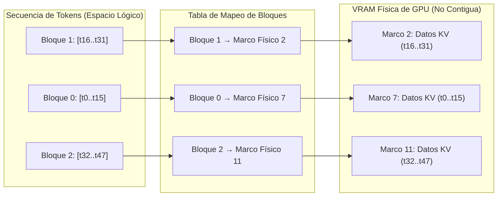

# Hardware de IA e Inferencia Eficiente: Aceleradores y Optimización de Serving

La inferencia en modelos de lenguaje masivos (LLMs) y arquitecturas generativas profundas impone restricciones computacionales heterogéneas que difieren de las presentes durante la fase de entrenamiento. Mientras que el pre-entrenamiento de redes neuronales profundas es una tarea intensiva en cómputo (*compute-bound*) dominada por operaciones de álgebra lineal densa en grandes lotes (*batches*), la generación autoregresiva de tokens durante la inferencia es un proceso intrínsecamente secuencial y frecuentemente limitado por el ancho de banda de memoria (*memory-bound*). Para desplegar modelos con decenas o cientos de miles de millones de parámetros en entornos de producción con baja latencia y alta concurrencia, la ingeniería moderna de sistemas de IA depende de un co-diseño estricto entre el silicio acelerador (GPUs con Tensor Cores, TPUs con matrices sistólicas) y técnicas algorítmicas de optimización de memoria y ejecución, tales como cuantización de precisión reducida (FP8, INT4, AWQ, GGUF), gestión no contigua de memoria dinámica mediante PagedAttention y aceleración del ciclo de decodificación vía decodificación especulativa (*Speculative Decoding*).

---

## 1. Origen e Intuición Fundamental

El punto de inflexión del hardware de IA ocurrió con la transición de unidades centrales de procesamiento (CPUs) basadas en arquitecturas Von Neumann de latencia mínima a procesadores vectoriales y matriciales masivamente paralelos diseñados para alto rendimiento sostenido (*throughput*). Los modelos basados en el mecanismo de autoatención (*Transformer*) exhiben dos fases operativas durante la inferencia:

1. **Fase de Prefill (Context Processing):** Procesa el prompt de entrada de longitud $T_{\text{in}}$ de manera paralela. Es intensiva en operaciones de punto flotante por segundo (FLOPs) y satura fácilmente las unidades de ejecución matricial de los aceleradores.
2. **Fase de Decodificación (Generation):** Genera cada nuevo token $y_t$ condicionado a la secuencia previa $y_{<t}$. Cada paso requiere transferir la totalidad de los pesos del modelo desde la memoria global (HBM/DRAM) hacia las memorias locales y cachés de los núcleos para computar una sola multiplicación matriz-vector.

El cuello de botella resultante se analiza mediante el **Modelo Roofline**, que relaciona el rendimiento alcanzable $P$ (FLOP/s) con la intensidad aritmética $I$ (FLOPs/byte):

$$P = \min(P_{\text{peak}}, I \times B_{\text{mem}})$$

Donde $P_{\text{peak}}$ representa el cómputo teórico máximo del acelerador y $B_{\text{mem}}$ es el ancho de banda de la memoria. En la fase de decodificación autoregresiva con tamaño de lote pequeño, la intensidad aritmética cae drásticamente por debajo del punto de corte del hardware, operando en la región *memory-bound*. La inferencia eficiente aborda esta disparidad reduciendo los bytes transferidos por parámetro (cuantización), reutilizando cómputos previos en SRAM (KV-Cache), eliminando fragmentaciones de asignación de memoria (PagedAttention) y aumentando la cantidad de tokens validados por transferencia de pesos (Speculative Decoding).

---

## 2. Arquitectura, Mecánica o Formulación Matemática

### 2.1 Aceleradores Matriciales: Tensor Cores y Matrices Sistólicas

Las GPUs modernas incorporan microarquitecturas especializadas para multiplicar matrices densas a nivel de hardware. Los **Tensor Cores** ejecutan operaciones de multiplicación y acumulación fusionadas (FMA) sobre matrices de pequeñas dimensiones en un único ciclo de instrucción:

$$D = A \times B + C$$

Donde $A, B \in \mathbb{R}^{M \times K}, \mathbb{R}^{K \times N}$ operan habitualmente en formatos de precisión reducida (FP16, BF16, FP8 o INT4) y el acumulador $C, D$ preserva la fidelidad en mayor precisión (FP32). 

Por su parte, las Unidades de Procesamiento Tensorial (**TPU**) emplean una **Matriz Sistólica** (*Systolic Array*). En esta arquitectura bidimensional de celdas computacionales cableadas, los datos de activación fluyen horizontalmente y los pesos verticalmente a través del arreglo de multiplicadores-acumuladores sin requerir lecturas ni escrituras continuas en los registros internos ni en la memoria SRAM intermedia, maximizando la eficiencia energética por FLOP.

### 2.2 Cuantización: FP8, INT4, AWQ y Formato GGUF

La cuantización proyecta un tensor continuo de parámetros de alta precisión $x \in \mathbb{R}$ en un retículo discreto $x_q \in \mathbb{Z}$ o en representaciones de punto flotante de bajo rango:

$$x_q = \text{clip}\left(\left\lfloor \frac{x}{S} \right\rceil + Z, \, q_{\min}, \, q_{\max}\right)$$

Donde $S$ es el factor de escala (*scale factor*) y $Z$ es el punto cero (*zero point*). La reconstrucción aproximada es $\hat{x} = S \times (x_q - Z)$.

* **FP8 (Floating Point 8-bit):** Introduce dos variantes estándar en silicio:
  * **E4M3 (1 signo, 4 exponente, 3 mantisa):** Diseñado para la fase de inferencia y activaciones, priorizando resolución numérica dentro de un rango dinámico acotado.
  * **E5M2 (1 signo, 5 exponente, 2 mantisa):** Conserva el rango dinámico de FP16, reservado principalmente para gradientes en entrenamiento.
* **AWQ (Activation-aware Weight Quantization):** Reconoce que no todos los pesos son igualmente relevantes. Al examinar el tensor de activaciones $X$, AWQ detecta el $1\%$ de canales con magnitudes salientes que concentran la mayor parte de la información semántica. En lugar de mantenerlos en FP16, escala estos canales críticos de pesos mediante un vector diagonal $s > 1$:
  
  $$W' = W \cdot \text{diag}(s), \quad X' = \text{diag}(s)^{-1} \cdot X$$
  
  Permitiendo cuantizar toda la matriz a INT4 sin distorsión severa de perplejidad y evitando la necesidad de kernels de ejecución mixta heterogénea.
* **GGUF (GPT-Generated Unified Format):** Formato binario autocontenido introducido por el ecosistema de *llama.cpp*. Almacena metadatos y tensores cuantizados en variantes como `Q4_K_M` o `Q5_K_S` (cuantización por bloques con escalas no lineales), permitiendo mapeo directo en memoria (*mmap*) y descarga selectiva de capas entre GPU (VRAM) y CPU (DRAM del sistema).

### 2.3 KV-Cache y PagedAttention

En el mecanismo de atención multicabezal estándar, la atención para el token $t$ sobre el historial se calcula como:

$$\text{Attention}(Q_t, K_{\le t}, V_{\le t}) = \text{softmax}\left(\frac{Q_t K_{\le t}^T}{\sqrt{d_k}}\right) V_{\le t}$$

Para evitar recomputar las matrices de claves ($K$) y valores ($V$) de los tokens pasados $1 \le i < t$, estas se almacenan en un búfer dinámico denominado **KV-Cache**. La huella de memoria consumida por una solicitud individual está acotada por:

$$M_{\text{KV}} = 2 \times n_{\text{layers}} \times n_{\text{heads\_kv}} \times d_{\text{head}} \times L_{\text{seq}} \times b_{\text{precision}}$$

Donde $n_{\text{heads\_kv}}$ refleja el número de cabezas de atención (reducidas en arquitecturas como *Grouped-Query Attention* o GQA).

El problema clásico en motores de serving radica en que los sistemas asignaban tensores contiguos en VRAM reservando el espacio para la longitud de contexto máxima teórica ($L_{\text{max}}$), induciendo fragmentación interna y externa de memoria de hasta un $60\%-80\%$.

**PagedAttention** resuelve esto inspirándose en la memoria virtual con paginación de los sistemas operativos. El espacio de la KV-Cache se fragmenta en bloques lógicos de tamaño fijo (por ejemplo, 16 tokens). Una tabla de páginas mapea estos bloques lógicos a bloques físicos no contiguos en la memoria física de la GPU:



Esta estructura viabiliza el uso de *Copy-on-Write* para bifurcaciones de secuencias (muestreo paralelo y búsqueda en haz) y reduce el desperdicio de VRAM a menos del $4\%$, incrementando el rendimiento del servidor por un factor de hasta $4\times$.

### 2.4 Decodificación Especulativa (Speculative Decoding)

La decodificación especulativa acelera la inferencia quebrando la dependencia temporal paso a paso. Se utiliza un modelo ligero y rápido denominado **Draft Model** ($M_q$) y un modelo principal de alta capacidad **Target Model** ($M_p$):

1. En cada iteración, el modelo borrador $M_q$ genera $K$ tokens de forma autoregresiva rápida.
2. Los $K$ tokens propuestos se alimentan en paralelo al modelo principal $M_p$ en un único paso hacia adelante (*forward pass*), el cual opera en régimen *compute-bound*.
3. Se acepta cada token $x_i$ secuencialmente según el criterio probabilístico:
   
   $$\text{Aceptar } x_i \text{ con probabilidad: } \alpha = \min\left(1, \frac{P_{M_p}(x_i \mid x_{<i})}{P_{M_q}(x_i \mid x_{<i})}\right)$$

Si un token $x_j$ es rechazado, la predicción de $M_p$ para esa posición reemplaza al token fallido y se descartan las predicciones posteriores, garantizando matemáticamente que la distribución de probabilidad resultante es **idéntica** a la que generaría $M_p$ de forma aislada.

```python
import torch

def speculative_step(x_context, draft_model, target_model, k_spec=3):
    """
    Ejecución esquemática de un paso de decodificación especulativa.
    """
    # 1. El modelo borrador genera K tokens de forma secuencial
    draft_tokens = []
    draft_probs = []
    curr_input = x_context
    
    for _ in range(k_spec):
        with torch.no_grad():
            logits_q = draft_model(curr_input)[:, -1, :]
            prob_q = torch.softmax(logits_q, dim=-1)
            next_token = torch.multinomial(prob_q, num_samples=1)
            
            draft_tokens.append(next_token)
            draft_probs.append(prob_q.gather(-1, next_token))
            curr_input = torch.cat([curr_input, next_token], dim=-1)
            
    draft_seq = torch.cat(draft_tokens, dim=-1) # Forma: [batch, K]
    
    # 2. El modelo principal evalúa los K tokens en un solo paso paralelo
    full_seq = torch.cat([x_context, draft_seq], dim=-1)
    with torch.no_grad():
        target_logits = target_model(full_seq)
        
    # Extraer distribuciones de probabilidad del Target Model
    target_probs = torch.softmax(target_logits[:, -(k_spec + 1):-1, :], dim=-1)
    
    # 3. Bucle de verificación con muestreo modificado
    accepted_tokens = []
    for i in range(k_spec):
        tok = draft_seq[:, i:i+1]
        p = target_probs[:, i, :].gather(-1, tok)
        q = draft_probs[i]
        
        # Criterio de aceptación estándar
        alpha = torch.clamp(p / (q + 1e-9), max=1.0)
        u = torch.rand_like(alpha)
        
        if u < alpha:
            accepted_tokens.append(tok)
        else:
            # Token rechazado: muestrear del residuo de probabilidad ajustado
            residual_prob = torch.clamp(target_probs[:, i, :] - draft_model(full_seq[:, :x_context.shape[1]+i])[:, -1, :].softmax(-1), min=0.0)
            residual_prob = residual_prob / residual_prob.sum(dim=-1, keepdim=True)
            corrected_token = torch.multinomial(residual_prob, num_samples=1)
            accepted_tokens.append(corrected_token)
            break # Salir anticipadamente tras el primer rechazo
            
    return torch.cat(accepted_tokens, dim=-1)
```

---

## 3. Casos de Uso y Aplicaciones Reales

* **Serving a Gran Escala con Motores Optimizados:** Servidores como **vLLM**, **TGI** (*Text Generation Inference*) y **TensorRT-LLM** integran PagedAttention, fusión de kernels en CUDA/Triton y decodificación especulativa para desplegar modelos de 70B a 405B de parámetros maximizando el *throughput* de tokens por segundo por dólar en clústeres de H100 y B200.
* **Inferencia Local y Edge Computing:** Motores como **llama.cpp** y **Ollama** implementan cuantización extrema (INT4/INT2 vía GGUF) en dispositivos de consumo (CPUs estándar, GPUs de gama media y arquitecturas con memoria unificada como Apple Silicon M-Series), permitiendo la ejecución de LLMs sin conexión externa.
* **Sistemas Conversacionales de Voz en Tiempo Real:** En asistentes de diálogo hablado, la latencia de primer token (*Time-to-First-Token* o TTFT) e inter-token (*Inter-Token Latency* o ITL) deben mantenerse por debajo de los 100 ms para sonar naturales. El empleo combinado de AWQ/FP8 y decodificación especulativa permite alcanzar aceleraciones de hasta $2.5\times$ en la tasa de generación.

---

## 4. Ventajas, Limitaciones y Riesgos

La optimización de hardware e inferencia exige un compromiso deliberado entre complejidad computacional, latencia y precisión de las salidas.

| Técnica / Enfoque | Ventaja Principal | Sobrecarga / Limitación | Impacto en Precisión / Latencia |
| :--- | :--- | :--- | :--- |
| **Tensor Cores / Matriz Sistólica** | Rendimiento pico teórico masivo (FLOPs) para GEMM denso. | Requiere dimensionamiento estricto de matrices (múltiplos de 8/16) y alta intensidad aritmética. | Fidelidad exacta si se usa precisión mixta; ineficiente en decodificación aislada. |
| **Cuantización FP8 / INT4 (AWQ)** | Reduce la huella de VRAM entre $50\%$ y $75\%$; duplica el ancho de banda efectivo. | Degradación potencial en tareas de razonamiento profundo o código si se baja de 4 bits sin calibración. | Descuido mínimo en perplejidad con AWQ; reducción sustancial en latencia ITL. |
| **Formato GGUF** | Portabilidad absoluta de modelos y soporte para *offloading* por capas entre GPU y CPU. | Desempeño limitado por la velocidad de la memoria del sistema (DDR4/DDR5) cuando no cabe en VRAM. | Idéntico a la cuantización subyacente; latencia variable según la cuota de CPU/GPU. |
| **PagedAttention** | Elimina casi el $100\%$ del desperdicio de memoria por fragmentación de KV-Cache. | Sobrecarga de direccionamiento indirecto a través de tablas de páginas; kernels CUDA específicos. | Cero pérdida matemática en salidas; multiplicación de concurrencia y *throughput*. |
| **Speculative Decoding** | Acelera la decodificación autoregresiva de $1.5\times$ a $3.0\times$ sin alterar la distribución teórica. | Demanda recursos de VRAM adicionales para alojar el *Draft Model*; ineficaz si la tasa de aceptación cae. | Garantía matemática de cero degradación respecto al *Target Model*. |

### Riesgos y Desafíos Técnicos

1. **Riesgo de Cuantización Espuria:** La compresión por debajo de 4 bits (INT3, INT2) induce degradaciones no lineales conocidas como *cliff effects*, donde el modelo pierde coherencia semántica en contextos extendidos o cálculos aritméticos.
2. **Desalineación del Draft Model:** Si la distribución de probabilidad del modelo borrador no coincide suficientemente con la del modelo objetivo (tasa de aceptación $\alpha < 0.5$), la decodificación especulativa ralentiza la inferencia debido a la sobrecarga computacional de validar tokens descartados.
3. **El Muro de la Memoria (Memory Wall):** A pesar de los avances en memorias HBM3e y CoWoS (*Chip-on-Wafer-on-Substrate*), la tasa de crecimiento del ancho de banda de memoria sigue siendo un orden de magnitud inferior a la capacidad de cómputo bruto de los aceleradores, forzando a la industria a priorizar la compresión de activaciones y el reuso temporal.

---

## 5. Conceptos Relacionados

* **Mecanismos de Atención Eficiente (FlashAttention):** Algoritmo que reordena los accesos de lectura/escritura de la atención mediante bloques (*tiling*) en la memoria SRAM de la GPU para evitar materializar la matriz de atención completa en HBM.
* **Paralelismo de Modelos (Tensor & Pipeline Parallelism):** Estrategias de particionamiento distribuido (Megatron-LM, DeepSpeed) para dividir capas o pesos entre múltiples aceleradores interconectados por interfaces de alta velocidad como NVLink.
* **Grouped-Query Attention (GQA) y Multi-Query Attention (MQA):** Variantes arquitectónicas del Transformer que reducen drásticamente el número de cabezas en la KV-Cache manteniendo la capacidad representacional de las cabezas de consulta.
* **Destilación y Poda de Modelos (Pruning):** Técnicas de compresión complementarias que eliminan conexiones no esenciales o transfieren la capacidad de un modelo maestro a un estudiante más compacto apto para servir como *draft model*.
