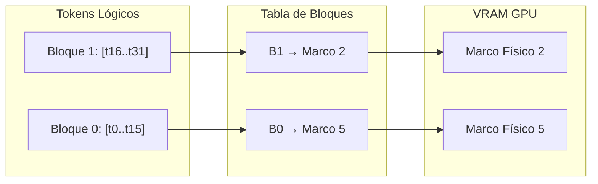

# Hardware de IA e Inferencia Eficiente: Aceleradores y Optimización de Serving

La inferencia en modelos de lenguaje masivos (LLMs) y arquitecturas profundas presenta desafíos computacionales fundamentalmente distintos a los del entrenamiento. Mientras que el entrenamiento es intensivo en cómputo (*compute-bound*) y procesa operaciones densas en lotes (*batches*) masivos, la decodificación autoregresiva es intrínsecamente secuencial y está limitada por el ancho de banda de memoria (*memory-bound*). Para desplegar modelos a escala con mínima latencia y máxima densidad de usuarios, la ingeniería de IA se apoya en el co-diseño de aceleradores especializados (GPUs con Tensor Cores, TPUs con matrices sistólicas) y algoritmos de optimización: cuantización de precisión reducida (FP8, INT4, AWQ, GGUF), gestión de memoria mediante PagedAttention y paralelismo temporal con decodificación especulativa.

---

## 1. Origen e Intuición Fundamental

El cuello de botella de la inferencia moderna se formaliza mediante el **Modelo Roofline**, que define el rendimiento alcanzable $P$ (FLOP/s) en función de la intensidad aritmética $I$ (FLOPs/byte) y el ancho de banda de memoria $B_{\text{mem}}$:

$$P = \min(P_{\text{peak}}, I \times B_{\text{mem}})$$

En la inferencia de transformadores surgen dos regímenes operativos:
1. **Fase de Prefill (Procesamiento de Contexto):** Procesa el prompt de longitud $T_{\text{in}}$ en paralelo. Posee alta intensidad aritmética y satura las unidades de cómputo matricial (*compute-bound*).
2. **Fase de Decodificación (Generación de Tokens):** Genera tokens uno a uno. Para cada nuevo token, deben transferirse decenas de gigabytes de parámetros desde la memoria de alto ancho de banda (HBM) a los núcleos de cómputo para realizar una única multiplicación matriz-vector ($I \ll 1$), operando en régimen *memory-bound*.

La inferencia eficiente busca desplazar este cuello de botella reduciendo los bytes leídos por parámetro (cuantización), evitando la recomputación de estados intermedios (KV-Cache), optimizando la fragmentación de memoria (PagedAttention) y aumentando los tokens generados por transferencia de pesos (decodificación especulativa).

---

## 2. Arquitectura, Mecánica o Formulación Matemática

### 2.1 Aceleradores Matriciales: Tensor Cores y Matrices Sistólicas

Las GPUs modernas incorporan **Tensor Cores**, unidades cableadas que ejecutan multiplicaciones de matrices en precisión mixta (FMA fusionado) en un solo ciclo:

$$D = A \times B + C$$

Donde $A$ y $B$ residen en precisión reducida (FP16, BF16, FP8 o INT4) y los acumuladores $C$ y $D$ mantienen fidelidad en FP32. En contraste, las **TPUs** adoptan una **Matriz Sistólica** (*Systolic Array*): una red bidimensional de celdas computacionales donde las activaciones fluyen horizontalmente y los pesos verticalmente, reutilizando valores intermedios sin acceder repetidamente a registros o SRAM.

### 2.2 Cuantización: FP8, INT4, AWQ y GGUF

La cuantización lineal mapea valores continuos $x \in \mathbb{R}$ a un rango discreto $x_q \in \mathbb{Z}$:

$$x_q = \text{clip}\left(\left\lfloor \frac{x}{S} \right\rceil + Z, \, q_{\min}, \, q_{\max}\right), \quad \hat{x} = S \times (x_q - Z)$$

Donde $S$ es el factor de escala y $Z$ el punto cero.
* **FP8 (8-bit Floating Point):** Soporta dos formatos estándar en silicio: **E4M3** (1 bit signo, 4 exponente, 3 mantisa), ideal para activaciones e inferencia por su mayor resolución numérica, y **E5M2** (1 signo, 5 exponente, 2 mantisa), que mantiene el rango dinámico de FP16.
* **AWQ (Activation-aware Weight Quantization):** Observa que solo un $1\%$ de los canales de activación contienen magnitudes salientes que determinan la perplejidad. En lugar de preservar estos pesos en FP16, AWQ aplica un escalado por canal $s > 1$:
  
  $$W' = W \cdot \text{diag}(s), \quad X' = \text{diag}(s)^{-1} \cdot X$$
  
  Esto reduce el error de redondeo relativo y permite cuantizar la matriz completa a INT4 con pérdida semántica casi nula.
* **Formato GGUF:** Diseñado por el proyecto *llama.cpp*, estructura tensores y metadatos en un archivo binario indexado (*mmap*), soportando cuantización por bloques no uniformes (`k-quants` como Q4_K_M) y facilitando el reparto de capas entre GPU (VRAM) y CPU (DRAM).

### 2.3 KV-Cache y PagedAttention

Para computar la atención autoregresiva sobre el contexto acumulado $\le t$:

$$\text{Attention}(Q_t, K_{\le t}, V_{\le t}) = \text{softmax}\left(\frac{Q_t K_{\le t}^T}{\sqrt{d_k}}\right) V_{\le t}$$

Las representaciones de clave ($K$) y valor ($V$) previas se retienen en una **KV-Cache** dinámica. El consumo de memoria crece linealmente con la longitud de secuencia $L$:

$$M_{\text{KV}} = 2 \times n_{\text{layers}} \times n_{\text{heads\_kv}} \times d_{\text{head}} \times L \times b_{\text{bytes}}$$

La asignación contigua convencional generaba hasta un $80\%$ de desperdicio por fragmentación interna y reserva estática. **PagedAttention** resuelve esto particionando la KV-Cache en bloques virtuales no contiguos mapeados dinámicamente mediante una tabla de páginas:



PagedAttention reduce la fragmentación a menos del $4\%$ y permite compartir bloques idénticos en memoria mediante *Copy-on-Write* durante decodificación paralela.

### 2.4 Decodificación Especulativa (Speculative Decoding)

Esta técnica desacopla la generación autoregresiva usando un modelo borrador rápido ($M_q$) y un modelo principal de alta fidelidad ($M_p$):
1. $M_q$ propone rápidamente $K$ tokens candidatos en pasos individuales.
2. $M_p$ procesa los $K$ candidatos en una única pasada paralela (*compute-bound*).
3. Cada token candidato $x_i$ se acepta secuencialmente con probabilidad:
   
   $$\alpha = \min\left(1, \frac{P_{M_p}(x_i \mid x_{<i})}{P_{M_q}(x_i \mid x_{<i})}\right)$$

Si un token es rechazado, se muestrea directamente del residuo normalizado de $P_{M_p}$, garantizando sin aproximaciones la misma distribución teórica de $M_p$.

```python
import torch

def speculative_verify(target_probs, draft_probs, draft_tokens):
    """
    Verifica y acepta/rechaza tokens especulados (batch=1).
    target_probs: [K, Vocab], draft_probs: [K], draft_tokens: [K]
    """
    accepted = []
    for i, tok in enumerate(draft_tokens):
        p = target_probs[i, tok]
        q = draft_probs[i]
        alpha = torch.clamp(p / (q + 1e-9), max=1.0)
        
        if torch.rand(1).item() < alpha.item():
            accepted.append(tok)
        else:
            # Token rechazado: muestrear del residuo positivo
            diff = torch.clamp(target_probs[i] - q, min=0.0)
            res_prob = diff / (diff.sum() + 1e-9)
            accepted.append(torch.multinomial(res_prob, 1).item())
            break
    return accepted
```

---

## 3. Casos de Uso y Aplicaciones Reales

* **Serving en Producción a Gran Escala:** Servidores como **vLLM**, **TGI** y **TensorRT-LLM** combinan PagedAttention, cuantización FP8/INT4 y *continuous batching* para multiplicar el rendimiento de solicitudes simultáneas en clusters H100 y B200.
* **Inferencia Local en Dispositivos de Consumo:** Motores como **llama.cpp** y **Ollama** utilizan cuantizaciones GGUF (INT4/INT5) y memoria unificada (Apple Silicon, CPU+iGPU) para ejecutar modelos de hasta 70B de parámetros en estaciones de trabajo y portátiles.
* **Asistentes de Voz y Agentes Interactivos:** Aplicaciones donde el *Time-to-First-Token* (TTFT) y la latencia inter-token deben permanecer por debajo de 50 ms emplean decodificación especulativa y AWQ para lograr respuestas fluidas en tiempo real.

---

## 4. Ventajas, Limitaciones y Riesgos

| Dimensión / Técnica | Beneficio Principal | Sobrecarga / Limitación | Impacto en Calidad |
| :--- | :--- | :--- | :--- |
| **Tensor Cores / Matriz Sistólica** | Rendimiento masivo en FLOPS para álgebra matricial. | Requiere paralelismo masivo y formas alineadas; ineficiente en decodificación aislada ($B=1$). | Exacto en precisión nativa; sin distorsión. |
| **Cuantización FP8 / INT4 (AWQ)** | Reduce el uso de VRAM en $50\%-75\%$ y alivia el ancho de banda. | Requiere calibración con activaciones reales y kernels específicos de descompresión. | Prácticamente imperceptible en 8/4 bits; riesgo de degradación por debajo de 3 bits. |
| **Formato GGUF** | Alta portabilidad y descarga híbrida entre GPU y RAM de sistema. | La velocidad cae drásticamente si una porción sustancial del modelo opera en DRAM de CPU. | Idéntico a la compresión numérica elegida. |
| **PagedAttention** | Elimina casi el $100\%$ del desperdicio de VRAM por fragmentación en KV-Cache. | Introduce sobrecarga de direccionamiento mediante tablas de bloques en kernels CUDA. | Cero pérdida matemática en logits o estados internos. |
| **Speculative Decoding** | Acelera la generación de $1.5\times$ a $2.5\times$ en latencia sin cambiar la distribución. | Requiere alojar dos modelos en memoria; pierde efectividad si la correlación decae ($\alpha < 0.5$). | Idéntico al modelo de referencia original. |

### Riesgos y Consideraciones
* **Degradación no lineal (*Cliff Effect*):** La cuantización sub-4-bit puede causar colapsos repentinos en tareas complejas de razonamiento formal o generación de código fuente.
* **El Muro de la Memoria (*Memory Wall*):** A pesar de los avances en memorias HBM3e, la tasa de transferencia de datos crece a un ritmo significativamente más lento que la potencia de cómputo de los aceleradores, manteniendo la decodificación como un problema de ancho de banda.

---

## 5. Conceptos Relacionados

* **FlashAttention (1, 2 y 3):** Algoritmo de atención consciente de la memoria que ejecuta la softmax por bloques (*tiling*) dentro de la SRAM rápida de la GPU para evitar escrituras y lecturas redundantes en HBM.
* **Grouped-Query Attention (GQA):** Arquitectura que agrupa múltiples cabezas de consulta para compartir una única cabeza de clave-valor, reduciendo el tamaño de la KV-Cache en un factor de hasta $8\times$.
* **Paralelismo Tensorial y de Pipeline (TP/PP):** Técnicas de particionamiento de matrices de pesos entre múltiples GPUs (vía interconexiones NVLink/NVSwitch) para modelos que superan la capacidad de un solo dispositivo.
* **Continuous Batching (Orca):** Programación a nivel de iteración que inserta nuevas secuencias en la fase de prefill tan pronto como una secuencia en decodificación finaliza, evitando pausas en el hardware.
