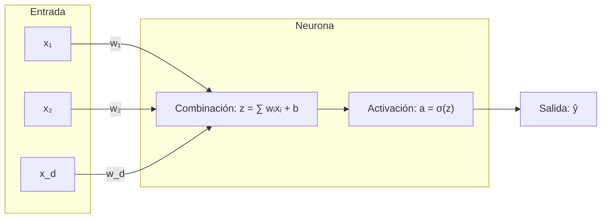

# Redes Neuronales Artificiales: Fundamentos, Dinámica de Aprendizaje y Optimización

Las **Redes Neuronales Artificiales** (ANN, por sus siglas en inglés) constituyen una clase fundamental de modelos computacionales inspirados en los principios biofísicos del procesamiento sináptico cerebral, estructurados formalmente como grafos acíclicos dirigidos donde unidades de cómputo distribuidas (neuronas) transforman representaciones numéricas de manera sucesiva. Diseñadas para resolver problemas de aproximación funcional, reconocimiento de patrones y modelado predictivo, procesan entradas continuas o discretas mediante composiciones de transformaciones afines parametrizadas seguidas de funciones de activación no lineales. En su variante fundamental, el perceptrón multicapa (*Multilayer Perceptron* o MLP), estos sistemas han establecido la base matemática y algorítmica sobre la cual descansa el aprendizaje profundo moderno.

---

## 1. Origen e Intuición Fundamental

El desarrollo conceptual de las redes neuronales se remonta a 1943 con el modelo de neurona binaria de Warren McCulloch y Walter Pitts. En 1958, Frank Rosenblatt introdujo el **Perceptrón**, dotado de pesos sinápticos adaptativos actualizados a partir del error y respaldado formalmente por el *Teorema de Convergencia del Perceptrón*, el cual garantiza convergencia si los datos son linealmente separables.



En 1969, Marvin Minsky y Seymour Papert demostraron las limitaciones estructurales del perceptrón simple frente a problemas no separables linealmente (como la función XOR), inaugurando un receso en el área. La superación teórica llegó con las redes multicapa y el **Teorema de Aproximación Universal** (Cybenko, 1989; Hornik, 1991), que establece que una red *feedforward* con una sola capa oculta suficiente y activaciones continuas no lineales puede aproximar cualquier función continua sobre compactos de $\mathbb{R}^n$ con precisión arbitraria.

Geométricamente, una neurona aísla el espacio mediante un hiperplano. Al apilar capas jerárquicas, la red deforma y proyecta el espacio latente, componiendo fronteras de decisión convexas y no lineales capaces de segregar variedades topológicas de alta dimensionalidad.

---

## 2. Arquitectura, Mecánica o Formulación Matemática

### A. Capa Feedforward y Transformación Afín

Para un vector de entrada $\mathbf{x} \in \mathbb{R}^{d_{in}}$, una capa densa efectúa una transformación afín parametrizada por pesos $\mathbf{W} \in \mathbb{R}^{d_{out} \times d_{in}}$ y sesgos $\mathbf{b} \in \mathbb{R}^{d_{out}}$:

$$\mathbf{z} = \mathbf{W}\mathbf{x} + \mathbf{b}, \qquad \mathbf{a} = \sigma(\mathbf{z})$$

donde $\sigma(\cdot)$ es una activación no lineal. Sin $\sigma(\cdot)$, $L$ capas lineales colapsarían en una única transformación lineal global, anulando toda ganancia por profundidad.

### B. Funciones de Activación

1. **Sigmoide Logística ($\sigma$):**
   $$\sigma(z) = \frac{1}{1 + e^{-z}}, \quad \sigma'(z) = \sigma(z)(1 - \sigma(z))$$
   Mapea a $(0, 1)$. Sufre de *desvanecimiento del gradiente* (*vanishing gradient*), pues su derivada máxima es $\sigma'(0) = 0.25$, saturándose en valores extremos.
2. **ReLU (*Rectified Linear Unit*):**
   $$\text{ReLU}(z) = \max(0, z), \quad \frac{d}{dz}\text{ReLU}(z) = \begin{cases} 1 & \text{si } z > 0 \\ 0 & \text{si } z < 0 \end{cases}$$
   Elimina la saturación para regímenes positivos y reduce el costo de cómputo, aunque puede causar inactivación irreversible de neuronas (*dying ReLU*).
3. **GELU (*Gaussian Error Linear Unit*):**
   $$\text{GELU}(z) = z \cdot \Phi(z) = z \cdot P(X \le z), \quad X \sim \mathcal{N}(0, 1)$$
   Aproximación empírica: $\text{GELU}(z) \approx 0.5z \left(1 + \tanh\left(\sqrt{2/\pi}(z + 0.044715 z^3)\right)\right)$. Predominante en arquitecturas Transformer modernas (BERT, GPT).
4. **Softmax:**
   Para clasificación con $K$ clases mutuamente excluyentes:
   $$\text{Softmax}(\mathbf{z})_i = \frac{e^{z_i}}{\sum_{j=1}^K e^{z_j}}$$

### C. Retropropagación del Error y Descenso de Gradiente

Dada una función de costo $L(\mathbf{y}, \hat{\mathbf{y}})$, la regla de la cadena multivariable define recursivamente el error de capa $\boldsymbol{\delta}^{(l)} \equiv \frac{\partial L}{\partial \mathbf{z}^{(l)}}$:

- **Capa terminal $L$:**
  $$\boldsymbol{\delta}^{(L)} = \nabla_{\mathbf{a}^{(L)}} L \odot \sigma'(\mathbf{z}^{(L)})$$
  *(Para entropía cruzada y Softmax: $\boldsymbol{\delta}^{(L)} = \hat{\mathbf{y}} - \mathbf{y}$)*.
- **Capas intermedias ($l < L$):**
  $$\boldsymbol{\delta}^{(l)} = \left( (\mathbf{W}^{(l+1)})^T \boldsymbol{\delta}^{(l+1)} \right) \odot \sigma'(\mathbf{z}^{(l)})$$
- **Gradientes y actualización:**
  $$\frac{\partial L}{\partial \mathbf{W}^{(l)}} = \boldsymbol{\delta}^{(l)} (\mathbf{a}^{(l-1)})^T, \qquad \mathbf{W}^{(l)} \leftarrow \mathbf{W}^{(l)} - \eta \frac{\partial L}{\partial \mathbf{W}^{(l)}}$$

```python
import numpy as np

class RedNeuronalMLP:
    """Perceptrón Multicapa vectorizado para clasificación binaria."""
    def __init__(self, dim_in: int, dim_oculta: int, lr: float = 0.05):
        self.lr = lr
        # Inicialización de He para estabilidad del gradiente con ReLU
        self.W1 = np.random.randn(dim_oculta, dim_in) * np.sqrt(2.0 / dim_in)
        self.b1 = np.zeros((dim_oculta, 1))
        self.W2 = np.random.randn(1, dim_oculta) * np.sqrt(2.0 / dim_oculta)
        self.b2 = np.zeros((1, 1))

    def forward(self, X: np.ndarray) -> np.ndarray:
        self.X = X
        self.z1 = np.dot(self.W1, X) + self.b1
        self.a1 = np.maximum(0.0, self.z1)  # ReLU
        self.z2 = np.dot(self.W2, self.a1) + self.b2
        self.a2 = 1.0 / (1.0 + np.exp(-np.clip(self.z2, -250, 250)))  # Sigmoide
        return self.a2

    def backward(self, Y: np.ndarray) -> float:
        n = Y.shape[1]
        loss = -np.mean(Y * np.log(self.a2 + 1e-12) + (1 - Y) * np.log(1 - self.a2 + 1e-12))
        
        # Retropropagación analítica por regla de la cadena
        delta2 = self.a2 - Y
        dW2 = np.dot(delta2, self.a1.T) / n
        db2 = np.sum(delta2, axis=1, keepdims=True) / n

        delta1 = np.dot(self.W2.T, delta2) * (self.z1 > 0)
        dW1 = np.dot(delta1, self.X.T) / n
        db1 = np.sum(delta1, axis=1, keepdims=True) / n

        self.W2 -= self.lr * dW2; self.b2 -= self.lr * db2
        self.W1 -= self.lr * dW1; self.b1 -= self.lr * db1
        return float(loss)
```

---

## 3. Casos de Uso y Aplicaciones Reales

1. **Modelado Predictivo Tabular y Detección de Fraude:**
   Scoring crediticio bancario y análisis transaccional de riesgo mediante extracción no lineal de correlaciones complejas.
2. **Cabezales de Decisión y Bloques Feedforward:**
   Integración como capas terminales en redes convolucionales (CNN) y subredes densas (*Position-wise FFN*) en cada bloque de los Transformers.
3. **Bioinformática y Química Computacional:**
   Predicción de perfiles farmacológicos QSAR y afinidad de unión ligando-receptor sobre descriptores moleculares densos.
4. **Redes Neuronales Informadas por la Física (PINNs):**
   Aproximación funcional de soluciones de ecuaciones diferenciales integrando restricciones físicas en la pérdida analítica.

---

## 4. Ventajas, Limitaciones y Riesgos

| Dimensión | Ventaja / Fortaleza | Limitación / Riesgo |
| :--- | :--- | :--- |
| **Capacidad Representacional** | Aproximadores universales; modelan interacciones no lineales sin ingeniería manual exhaustiva. | Proclives al sobreajuste (*overfitting*) en regímenes con pocos datos o sin regularización. |
| **Escalabilidad** | Paralelización masiva y aceleración eficiente en hardware especializado (GPU/TPU). | Entrenamiento computacionalmente intensivo; sensibilidad crítica a hiperparámetros. |
| **Interpretabilidad** | Extraen representaciones latentes jerárquicas de alto nivel. | Comportamiento de "caja negra"; alta opacidad en auditorías de sistemas críticos. |
| **Optimización** | Backpropagation calcula derivadas exactas en tiempo lineal $O(E)$. | No convexidad del espacio de optimización; vulnerabilidad a mínimos locales y mesetas. |

---

## 5. Conceptos Relacionados

- **Aprendizaje Profundo (Deep Learning):** Arquitecturas neuronales jerárquicas con decenas o cientos de capas sucesivas.
- **Descenso de Gradiente Estocástico (SGD) y Optimizadores Adaptativos:** Algoritmos como Adam y AdamW para la navegación eficiente del espacio de parámetros.
- **Técnicas de Regularización (Dropout, Normalización por Lotes y Weight Decay):** Métodos fundamentales para controlar la varianza y mejorar la generalización.
- **Redes Convolucionales (CNN) y Modelos Transformer:** Especializaciones que introducen sesgos inductivos espaciales y atencionales sobre la arquitectura densa base.
